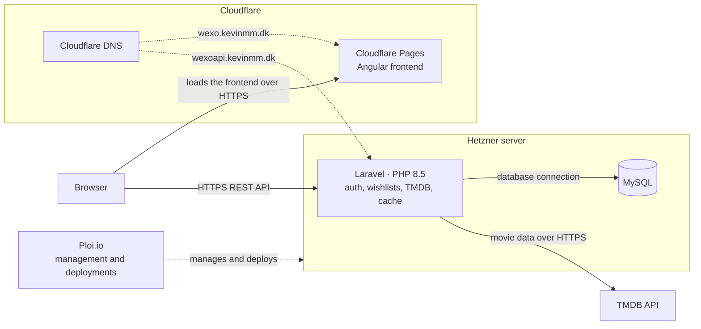
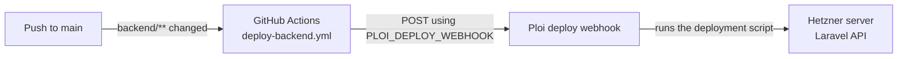

# FRAME

FRAME is a movie discovery application. The Angular frontend talks to a Laravel API. Movie data and images come from [The Movie Database (TMDB)](https://www.themoviedb.org/).

Signed-in users can:

- Browse movies and genres
- Search for movies
- Open a film for details, credits, and related titles
- Save and remove films on a personal wishlist
- Register and sign in

## Tech stack

| Area | Technologies |
| --- | --- |
| Frontend | Angular 22, TypeScript, Tailwind CSS, Angular Signals |
| Backend | Laravel 13, PHP 8.4 locally (PHP 8.5 in production), Laravel Sanctum, MySQL 8.0, Laravel database cache |
| External | TMDB API |
| Infrastructure | Cloudflare Pages, Cloudflare DNS, Ploi.io, Hetzner, DDEV |

Authentication uses Sanctum session cookies. The API does not use personal access tokens.

## Architecture

The browser loads the Angular app and calls the Laravel REST API. Laravel authenticates users, stores users and wishlists in MySQL, and requests movie data from TMDB. Successful TMDB responses are cached. Poster and backdrop files are loaded in the browser from TMDB's image host.

| Environment | Frontend | API |
| --- | --- | --- |
| Production | https://wexo.kevinmm.dk | https://wexoapi.kevinmm.dk |
| Local | http://localhost:4200 | https://frame-backend.ddev.site |



## Hosting

**Frontend.** The Angular app is hosted on Cloudflare Pages. Cloudflare DNS serves the domain. The site is https://wexo.kevinmm.dk.

**Backend.** Laravel runs on a Hetzner server managed with Ploi.io, including the site configuration and deployments. The server runs a web server with PHP 8.5. MySQL is on the same server. The API is https://wexoapi.kevinmm.dk.

## Deployment

A push to `main` deploys the Laravel API only when files under `backend/` change. GitHub Actions sends a POST request to the Ploi deploy webhook. Ploi then runs its deployment script on the Hetzner server. The webhook URL is not stored in the repository.

The workflow is `.github/workflows/deploy-backend.yml`. It listens for pushes to `main` with the path filter `backend/**`. The job runs on `ubuntu-latest` and calls the webhook with `curl`. The URL comes from the Actions secret `PLOI_DEPLOY_WEBHOOK`.

Pushing to `main` is what starts a deployment. These changes start one:

- Any file under `backend/**`

These changes do not:

- `frontend/**`
- `docs/**`
- Root files, such as this README

Ploi.io holds the server connection and the deployment script. Hetzner is the machine that script updates. This repository does not define that script.



## Project structure

```text
/
├── .github/workflows/deploy-backend.yml
├── frontend/          Angular application
├── backend/           Laravel application
│   └── .ddev/         DDEV configuration
├── docs/              Architecture notes and development guidelines
└── README.md
```

## Local development

DDEV runs only the Laravel app. From `backend/`, the project name is `frame-backend`, with PHP 8.4, nginx-fpm, and MySQL 8.0. Inside DDEV, MySQL is reached at host `db`. The credentials are the DDEV defaults in `backend/.env.example`.

### Backend

```bash
cd backend
copy .env.example .env
ddev start
ddev composer install
ddev artisan key:generate
ddev artisan migrate
```

On macOS or Linux, use `cp .env.example .env` instead of `copy`. Put a TMDB read access token in `TMDB_ACCESS_TOKEN`. Leave `TMDB_API_KEY` empty unless there is no token.

The API is at https://frame-backend.ddev.site. Stop it with:

```bash
cd backend
ddev stop
```

### Frontend

```bash
cd frontend
npm install
copy src\environments\environment.example.ts src\environments\environment.development.ts
npm start
```

On macOS or Linux, use `cp src/environments/environment.example.ts src/environments/environment.development.ts`.

`npm start` runs `ng serve` at http://localhost:4200. The browser calls https://frame-backend.ddev.site directly. Keep `apiBaseUrl` at that origin in `environment.development.ts`.

Start DDEV before `npm start`.

## Environment configuration

Secrets are not committed. `backend/.env` and `frontend/src/environments/environment.development.ts` are ignored. Copy the example files above and fill in local values only.

`backend/.env.example` lists the database, session, Sanctum, CORS, and TMDB settings. Do not commit API tokens, the application key, or database passwords. The production build reads `apiBaseUrl` from `frontend/src/environments/environment.ts` (`https://wexoapi.kevinmm.dk/api`).

Local DDEV and production use different cookie settings because localhost and `frame-backend.ddev.site` are different sites, while `wexo.kevinmm.dk` and `wexoapi.kevinmm.dk` are the same site. After changing the server `.env`, run `php artisan config:clear` there.

| Setting | Local DDEV | Production |
| --- | --- | --- |
| `SESSION_DOMAIN` | `null` | `null` |
| `SESSION_SECURE_COOKIE` | `true` | `true` |
| `SESSION_SAME_SITE` | `none` | `lax` |
| `SESSION_PARTITIONED_COOKIE` | `true` | `false` |
| `SANCTUM_STATEFUL_DOMAINS` | `localhost,localhost:4200,127.0.0.1,127.0.0.1:4200` | `wexo.kevinmm.dk` |
| `CORS_ALLOWED_ORIGINS` | `http://localhost:4200,http://127.0.0.1:4200` | `https://wexo.kevinmm.dk` |
