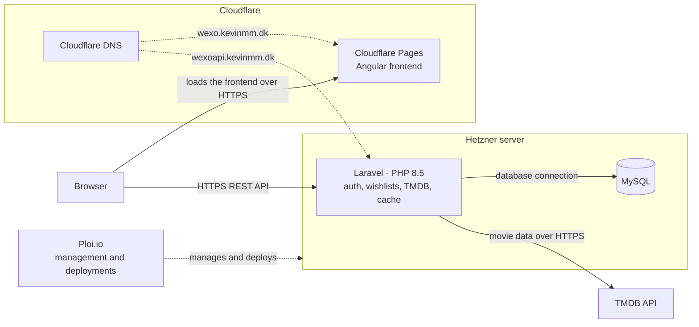
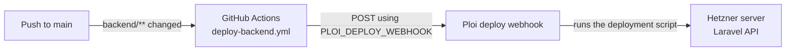

# FRAME

FRAME is a movie discovery application built for the WEXO Code Challenge. It helps a signed-in user find a film, read about it, see where it can be watched in Denmark, and keep a personal list of titles worth returning to.

The Angular frontend talks only to a Laravel API. Movie data and images come from [The Movie Database (TMDB)](https://www.themoviedb.org/). TMDB credentials stay on the server.

## Live demo

The running application is public. Sign in is required after the login screen.

| | |
| --- | --- |
| Frontend | https://wexo.kevinmm.dk |
| Backend API | https://wexoapi.kevinmm.dk |

## Contents

- [Features](#features)
- [WEXO Code Challenge](#wexo-code-challenge)
- [Tech stack](#tech-stack)
- [Architecture](#architecture)
- [Hosting](#hosting)
- [Deployment](#deployment)
- [Prerequisites](#prerequisites)
- [Local development](#local-development)
- [Environment configuration](#environment-configuration)
- [Testing](#testing)
- [API](#api)
- [Project structure](#project-structure)

## Features

### Discovery

- Homepage with a trending film and genre rows
- Genre overview, plus a genre page that can be sorted by popular, latest, or top rated
- Movie search from the header
- Movie details, including overview, runtime, rating, and genres
- Cast and crew, with a longer cast list on its own tab
- Similar films, taken from TMDB recommendations
- Desktop and phone layouts

The catalogue pages require a signed-in user. Login and registration are the only open screens.

### Accounts and wishlist

- Registration, login, and logout with a session cookie
- A personal wishlist
- The wishlist is stored in MySQL for that user, not in the browser

### Watching

- An embedded YouTube trailer in a modal, when TMDB has a trailer or teaser that can be embedded
- Where to watch in Denmark: streaming, rent, and buy, with provider logos
- The provider row is hidden when Denmark has no offers
- JustWatch is credited wherever that availability is shown

## WEXO Code Challenge

FRAME is the submission for the WEXO Code Challenge. The project's decision record describes that challenge as a movie discovery application another developer can run and extend. The areas named for that application are the homepage, genres, movie details, search, and a wishlist.

Those areas are implemented.

The Angular setup notes kept the wishlist in the browser and expected the frontend to call TMDB. This repository does not do that. Accounts, the API, and the database wishlist were added so the list survives a new browser and so TMDB credentials never reach the client. They are not described as challenge requirements in those notes.

Also added in this implementation, and not described there as requirements:

| Addition | Why it is here |
| --- | --- |
| Laravel API and Sanctum sessions | Keeps credentials and the wishlist on the server |
| Denmark streaming, rent, and buy | Shows where a film can be watched without leaving FRAME |
| Embedded trailer | Plays the trailer in the app instead of opening YouTube |
| Cloudflare, Hetzner, Ploi, and GitHub Actions | Publishes a build that can be reviewed |
| Phone layout for the movie page | Makes the detail page usable on a narrow screen |

## Tech stack

Versions below are the ranges or pins in this repository. Production PHP is the version used on the server, not a Composer constraint.

| Area | Technologies |
| --- | --- |
| Frontend | Angular 22, TypeScript 6, Tailwind CSS 4, Angular Signals, RxJS 7, SCSS |
| Backend | Laravel 13, PHP 8.4 locally (PHP 8.5 in production), Laravel Sanctum 4, MySQL 8.0, Laravel database cache |
| Tests and style | Vitest 5, Angular ESLint, Prettier, PHPUnit 12, Laravel Pint |
| External | TMDB API |
| Infrastructure | Cloudflare Pages, Cloudflare DNS, Ploi.io, Hetzner, DDEV, GitHub Actions |

Authentication uses Sanctum session cookies. The API does not use personal access tokens.

Composer accepts PHP 8.3 or newer. DDEV is configured for PHP 8.4. The frontend `engines` field accepts Node.js 22.22.3, 24.15.0, or 26 and newer.

## Architecture

The browser loads the Angular app and calls the Laravel REST API. Laravel authenticates users, stores users and wishlists in MySQL, and requests movie data from TMDB. Successful TMDB responses are cached. Poster and backdrop files are loaded in the browser from TMDB's image host.

Ploi.io manages the Hetzner server and runs deployments. It is not a service the browser calls.

| Environment | Frontend | API |
| --- | --- | --- |
| Production | https://wexo.kevinmm.dk | https://wexoapi.kevinmm.dk |
| Local | http://localhost:4200 | https://frame-backend.ddev.site |



## Hosting

**Frontend.** The Angular app is hosted on Cloudflare Pages. Cloudflare DNS serves the domain. The site is https://wexo.kevinmm.dk.

**Backend.** Laravel runs on a Hetzner server managed with Ploi.io, including the site configuration and deployments. The server runs a web server with PHP 8.5. MySQL is on the same server. The API is https://wexoapi.kevinmm.dk.

## Deployment

A push to `main` deploys the Laravel API only when files under `backend/` change. GitHub Actions sends a POST request to the Ploi deploy webhook. Ploi then runs its deployment script on the Hetzner server. The webhook URL is not stored in the repository.

The workflow is `.github/workflows/deploy-backend.yml`. It listens for pushes to `main` with the path filter `backend/**`. The job runs on `ubuntu-latest` and calls the webhook with `curl`. The URL comes from the Actions secret `PLOI_DEPLOY_WEBHOOK`.

Pushing to `main` is what starts a deployment. These changes start one:

- Any file under `backend/**`

These changes do not:

- `frontend/**`
- `docs/**`
- Root files, such as this README

Ploi.io holds the server connection and the deployment script. Hetzner is the machine that script updates. This repository does not define that script.



## Prerequisites

Install these on the machine that will run FRAME locally:

| Tool | Role |
| --- | --- |
| Git | Clone the repository |
| Docker | Runs the DDEV containers |
| DDEV | Runs Laravel, nginx, and MySQL |
| Node.js and npm | Runs the Angular app |

Node.js must satisfy the frontend `engines` field: `^22.22.3`, `^24.15.0`, or `>=26`. npm is the package manager named in `frontend/package.json`.

DDEV supplies PHP 8.4 and Composer 2 inside the project. A separate PHP or Composer install on the host is not required for the steps below. Docker must be running before `ddev start`.

## Local development

DDEV runs only the Laravel app. From `backend/`, the project name is `frame-backend`, with PHP 8.4, nginx-fpm, and MySQL 8.0. Inside DDEV, MySQL is reached at host `db`. The credentials are the DDEV defaults in `backend/.env.example`.

### Backend

```bash
cd backend
copy .env.example .env
ddev start
ddev composer install
ddev artisan key:generate
ddev artisan migrate
```

On macOS or Linux, use `cp .env.example .env` instead of `copy`. Put a TMDB read access token in `TMDB_ACCESS_TOKEN`. Leave `TMDB_API_KEY` empty unless there is no token.

The API is at https://frame-backend.ddev.site. Stop it with:

```bash
cd backend
ddev stop
```

### Frontend

```bash
cd frontend
npm install
copy src\environments\environment.example.ts src\environments\environment.development.ts
npm start
```

On macOS or Linux, use `cp src/environments/environment.example.ts src/environments/environment.development.ts`.

`npm start` runs `ng serve` at http://localhost:4200. The browser calls https://frame-backend.ddev.site directly. Keep `apiBaseUrl` at that origin in `environment.development.ts`.

Start DDEV before `npm start`.

## Environment configuration

Secrets are not committed. `backend/.env` and `frontend/src/environments/environment.development.ts` are ignored. Copy the example files above and fill in local values only.

`backend/.env.example` lists the database, session, Sanctum, CORS, and TMDB settings. Do not commit API tokens, the application key, or database passwords. The production build reads `apiBaseUrl` from `frontend/src/environments/environment.ts` (`https://wexoapi.kevinmm.dk/api`). Both environment files also set `imageBaseUrl` to `https://image.tmdb.org/t/p`.

Local DDEV and production use different cookie settings because localhost and `frame-backend.ddev.site` are different sites, while `wexo.kevinmm.dk` and `wexoapi.kevinmm.dk` are the same site. After changing the server `.env`, run `php artisan config:clear` there.

| Setting | Local DDEV | Production |
| --- | --- | --- |
| `SESSION_DOMAIN` | `null` | `null` |
| `SESSION_SECURE_COOKIE` | `true` | `true` |
| `SESSION_SAME_SITE` | `none` | `lax` |
| `SESSION_PARTITIONED_COOKIE` | `true` | `false` |
| `SANCTUM_STATEFUL_DOMAINS` | `localhost,localhost:4200,127.0.0.1,127.0.0.1:4200` | `wexo.kevinmm.dk` |
| `CORS_ALLOWED_ORIGINS` | `http://localhost:4200,http://127.0.0.1:4200` | `https://wexo.kevinmm.dk` |

`TMDB_BASE_URL` is `https://api.themoviedb.org/3`. Set `TMDB_ACCESS_TOKEN` locally and on the server. `TMDB_API_KEY` is the fallback when no token is set.

## Testing

### Backend

From `backend/`, with DDEV running:

```bash
ddev exec php artisan test
```

PHPUnit covers authentication, the TMDB proxy, and the wishlist. The test run uses in-memory SQLite, which `phpunit.xml` sets. It does not use the DDEV MySQL database.

Laravel Pint checks PHP formatting:

```bash
ddev exec vendor/bin/pint
```

Pass paths to limit what it formats, for example `ddev exec vendor/bin/pint app tests`. Inside DDEV, `pint --dirty` is not available.

### Frontend

From `frontend/`:

```bash
npm test
npm run lint
npm run format:check
```

`npm test` runs Vitest once. The specs cover the app shell, TMDB response mapping, and the wishlist service. `npm run lint` runs Angular ESLint. `npm run format:check` runs Prettier in check mode. `npm run format` writes Prettier changes.

There is no end-to-end test suite.

## API

Catalogue routes are public. Wishlist routes and `GET /api/user` require a Sanctum session. Registration and login are session routes outside `/api`.

| Method | Endpoint | Auth | Purpose |
| --- | --- | --- | --- |
| POST | `/register` | No | Create an account |
| POST | `/login` | No | Start a session |
| POST | `/logout` | Session | End the session |
| GET | `/api/user` | Sanctum | Current user |
| GET | `/api/movies/search` | No | Search films |
| GET | `/api/movies/{movieId}` | No | Film details |
| GET | `/api/genres` | No | Genre names |
| GET | `/api/wishlist` | Sanctum | Saved films |

The full list, including credits, videos, watch providers, recommendations, and genre films, is in [docs/api.md](docs/api.md).

## Project structure

```text
/
├── .github/workflows/deploy-backend.yml
├── frontend/          Angular application
├── backend/           Laravel application
│   └── .ddev/         DDEV configuration
├── docs/              API reference and architecture notes
│   ├── api.md
│   ├── architecture.md
│   ├── development-guidelines.md
│   └── decisions/
└── README.md
```
